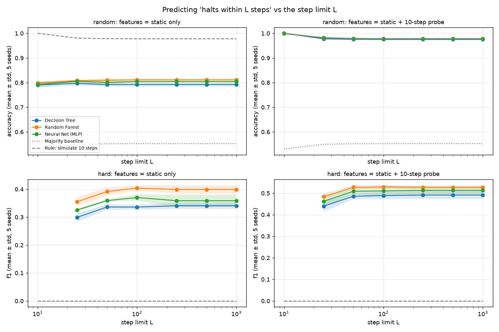
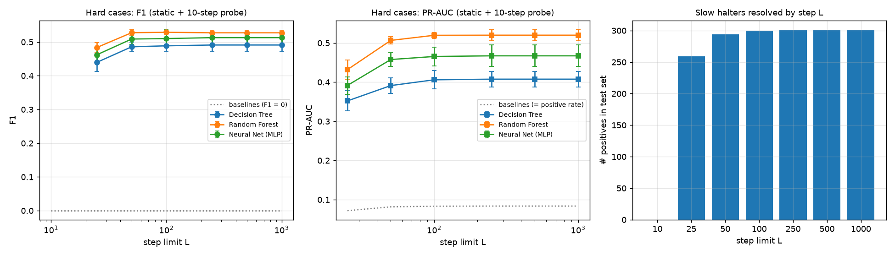
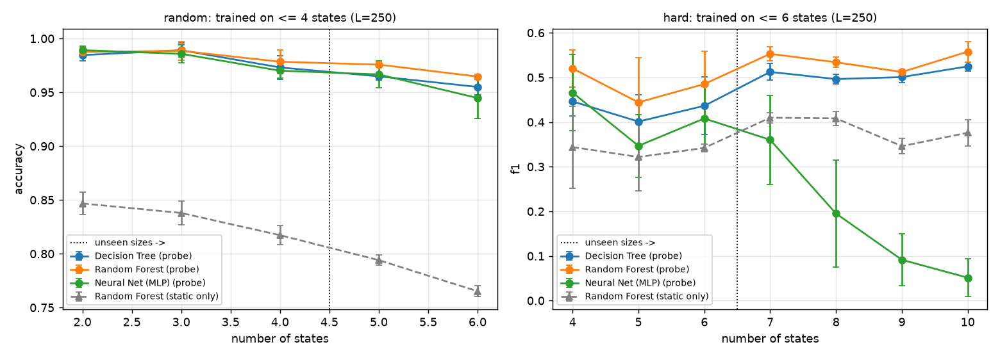
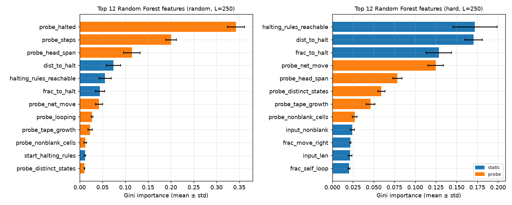
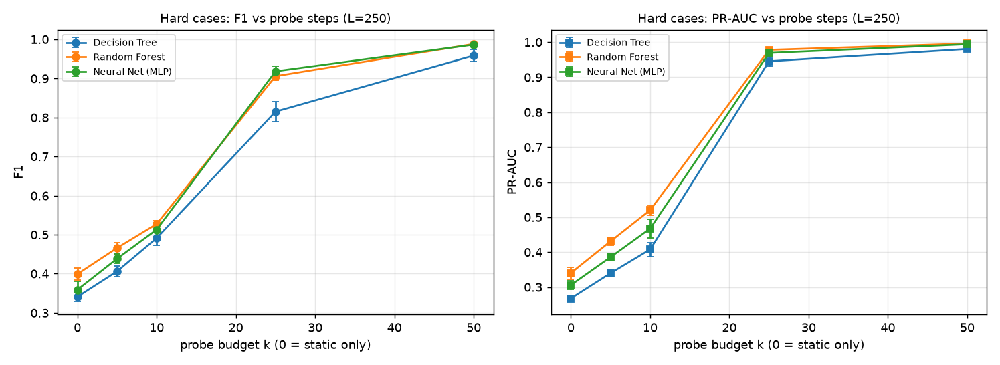

# Experimental Report: Turing Machine Simulation and Bounded Halting Prediction

## 1. Executive Summary

This project implements a configurable single-tape Turing machine simulator paired with a machine-learning triage layer that predicts whether a `(machine, input)` pair will **halt within a step budget $L$**. Across 6,000 random machines and 6,000 probe-filtered "hard" machines evaluated over 3 stratified split seeds and 7 step limits ($L \in \{10, 25, 50, 100, 250, 500, 1000\}$):

- **Theoretical honesty:** The simulator strictly separates **halted**, **provably looping** (exact/hashed configuration repetition), and **limit reached** (unknown). Class `0` in ML means *"has not halted within $L$ steps"*, never *"does not halt"*.
- **Unfiltered random machines:** Most random halters terminate quickly, so a simple 10-step simulation rule achieves **97.9% ± 0.4%** accuracy at $L = 250$. ML on static transition-table features alone reaches **80.9% ± 0.2%** accuracy (Random Forest) and **80.8% ± 0.3%** (Balanced MLP) without executing a single step.
- **Hard unresolved cases (post-10-step probe):** Naive baselines score **0.000 F1** (`0.033` PR-AUC). Adding a 10-step execution probe lets Random Forest reach **0.478 ± 0.043 F1** (`0.968` ROC-AUC, `0.400` PR-AUC, `81.4%` recall), Balanced MLP reach **0.455 ± 0.093 F1** (`0.968` ROC-AUC, **`0.444` PR-AUC**), and Decision Tree reach **0.437 ± 0.035 F1** (**`92.1%` recall**). Thus ML serves effectively as a **triage filter** prioritizing which machines warrant long simulation.

---

## 2. Theory of Computation Foundations

### 2.1 Turing Machine Formalism
A deterministic single-tape Turing machine is defined as $M = (Q, \Sigma, \Gamma, \delta, q_0, \sqcup, H)$, where:
- $Q$ is a finite set of states, $q_0 \in Q$ is the start state, and $H$ is the halting state.
- $\Gamma$ is the tape alphabet containing the blank symbol $\sqcup$ (default `_`) and input alphabet $\Sigma \subseteq \Gamma \setminus \{\sqcup\}$.
- $\delta: Q \times \Gamma \rightharpoonup \Gamma \times \{L, R, S\} \times (Q \cup \{H\})$ is a partial transition function. A missing rule for $(q, a)$ halts the machine cleanly in $H$.

### 2.2 Decidability & The Halting Problem
The general Halting Problem $H_{\text{TM}} = \{\langle M, w \rangle \mid M \text{ halts on } w\}$ is **undecidable** (Turing, 1936): no algorithm can decide halting for all $\langle M, w \rangle$. By contrast, the **bounded halting problem**:
$$H_{\text{TM}}^{\le L} = \{\langle M, w \rangle \mid M \text{ halts on } w \text{ within } L \text{ steps}\}$$
is **decidable** in $O(L)$ simulation steps.

Because non-halting machines cannot always be detected (e.g., `q0 _ 1 R q0` writes `1`s endlessly without ever repeating a configuration), our simulator ([tm.py](tm.py)) outputs three distinct statuses:

| Simulator Status | Meaning | Decidability Guarantee |
|---|---|---|
| `halted` | Reached `H` or missing rule within budget | Proven to halt at step $t \le L$ |
| `looping` | Full configuration `(state, head, tape)` repeated | **Provably never halts** (deterministic cycle) |
| `limit` | Step budget $L$ exhausted | **Unknown** (may halt at $L+1$ or run forever) |

---

## 3. System Architecture & Dataset

### 3.1 Simulator & Interactive Lab ([tm.py](tm.py), [app.py](app.py))
- **Tape model:** Sparse infinite tape (`dict[int, str]`) supporting negative and positive cell indices, configurable blank symbol and start state, and custom single-character tape alphabets.
- **Cycle detection:** Supports both fast 64-bit incremental Zobrist tape hashing and exact canonical `(state, head, frozenset(tape.items()))` verification (`exact_loop_check=True`).
- **Interactive Streamlit UI:** 4 tabs — step-through simulator with live Graphviz state transition diagram, multi-model halting predictor (`Decision Tree`, `Random Forest`, `Neural Net (MLP)`) with batch evaluator, experimental plots/tables, and theory notes.

### 3.2 Datasets ([dataset_random.csv](results/dataset_random.csv), [dataset_hard.csv](results/dataset_hard.csv))
Each dataset contains **6,000 deduplicated `(machine, input)` pairs** storing the serialized transition rules (`rules`), `input_str`, 10-step `probe_trace`, extracted features, ground-truth `status` up to `MAX_LIMIT = 1000`, and `halt_step`:

| Population | Machine Distribution | Halted | Looping | Limit (1000) | Purpose |
|---|---|---|---|---|---|
| `random` | 2–6 states, `p_halt ∈ [0.03, 0.30]` | 3,315 (55.3%) | 326 (5.4%) | 2,359 (39.3%) | Baseline behavior of unfiltered random TMs |
| `hard` | 4–10 states, `p_halt ∈ [0.001, 0.04]`, `allow_stay` 25%, filtered to `limit` at step 10 | 198 (3.3%) | 396 (6.6%) | 5,406 (90.1%) | Non-trivial slow halters unresolved after 10 steps |

### 3.3 Feature Engineering ([features.py](features.py))
- **19 Static features** (no execution): state/rule counts, `alphabet_size`, transition ratios (`frac_to_halt`, `frac_move_right`, `frac_move_stay`, `frac_write_blank`, `frac_self_loop`), structural motifs (`sweepers_right`, `sweepers_left`, `runaway_writers`), BFS state-graph reachability (`reachable_states`, `dist_to_halt`, `halting_rules_reachable`, `start_halting_rules`), and input descriptors (`input_len`, `input_nonblank`, `input_unique_symbols`, `input_ones`).
- **8 Probe features** (`PROBE_STEPS = 10`): `probe_halted`, `probe_looping`, `probe_steps`, `probe_distinct_states`, `probe_head_span`, `probe_net_move`, `probe_nonblank_cells`, `probe_tape_growth`.

---

## 4. Experimental Methodology ([experiment.py](experiment.py), [ml_models.py](ml_models.py))

- **Models:**
  1. **Decision Tree** (`max_depth=8`, `class_weight="balanced"`)
  2. **Random Forest** (`n_estimators=120`, `max_depth=14`, `class_weight="balanced"`)
  3. **Balanced MLP Neural Network** (`BalancedMLP`: `StandardScaler` + `MLPClassifier((64, 32), early_stopping=True)` with minority-class oversampling strictly inside `fit()` on each training fold so test folds remain untouched)
- **Baselines:** `Majority baseline` and `Rule: simulate 10 steps` (predicts `1` iff `probe_halted == 1`).
- **Validation:** 3 stratified 70/30 train/test splits (`SEEDS = [42, 43, 44]`, `n_test = 1,800`), reporting mean ± std for Accuracy, Precision, Recall, F1, ROC-AUC, and PR-AUC (Average Precision).

---

## 5. Results & Analysis

### 5.1 Random Population Across Step Limits


At $L = 250$ (`n_pos_test = 994 / 1,800`, 55.2% positive):

| Features | Model | Accuracy | F1 | ROC-AUC | PR-AUC |
|---|---|---|---|---|---|
| — | Majority baseline | 0.552 ± 0.000 | 0.712 ± 0.000 | 0.500 | 0.552 |
| — | Rule: simulate 10 steps | 0.979 ± 0.004 | 0.980 ± 0.004 | 0.981 | 0.983 |
| static only | Decision Tree | 0.794 ± 0.011 | 0.819 ± 0.010 | 0.856 | 0.827 |
| static only | Random Forest | **0.809 ± 0.002** | **0.836 ± 0.002** | **0.887** | 0.885 |
| static only | Neural Net (MLP) | 0.808 ± 0.003 | 0.832 ± 0.002 | 0.885 | **0.887** |
| static + probe | Decision Tree | 0.977 ± 0.003 | 0.979 ± 0.003 | 0.995 | 0.993 |
| static + probe | Random Forest | **0.978 ± 0.003** | **0.980 ± 0.003** | **0.999** | **0.999** |
| static + probe | Neural Net (MLP) | **0.978 ± 0.004** | **0.980 ± 0.004** | **0.999** | **0.999** |

**Finding:** On unfiltered random machines, almost every machine that halts does so within 10 steps. Static features still provide substantial signal (+25.7 pp over majority guessing without running the TM), while adding the 10-step probe ties the 10-step simulation rule.

### 5.2 Hard Cases (Unresolved After 10-Step Probe)


On `hard` cases, both baselines score **0.000 F1** (`0.033` PR-AUC) at $L \ge 25$. At $L = 250$ (`n_pos_test = 59 / 1,800`, 3.3% positive):

| Features | Model | Accuracy | Precision | Recall | F1 | ROC-AUC | PR-AUC |
|---|---|---|---|---|---|---|---|
| — | Majority / 10-step rule | 0.967 | 0.000 | 0.000 | 0.000 | 0.500 | 0.033 |
| static only | Decision Tree | 0.869 ± 0.015 | 0.174 | 0.791 | 0.285 ± 0.018 | 0.840 | 0.170 |
| static only | Random Forest | 0.914 ± 0.009 | 0.205 | 0.565 | 0.301 ± 0.030 | 0.930 | 0.237 |
| static only | Neural Net (MLP) | 0.948 ± 0.004 | 0.276 | 0.356 | 0.309 ± 0.031 | 0.932 | 0.239 |
| static + probe | Decision Tree | 0.922 ± 0.006 | 0.287 | **0.921** | 0.437 ± 0.035 | 0.923 | 0.278 |
| static + probe | Random Forest | 0.942 ± 0.005 | 0.339 | 0.814 | **0.478 ± 0.043** | **0.968** | 0.400 |
| static + probe | Neural Net (MLP) | **0.958 ± 0.010** | **0.406** | 0.525 | 0.455 ± 0.093 | **0.968** | **0.444** |

**Finding:** Fixing class imbalance via training-fold oversampling brought Balanced MLP into competitive range with Random Forest (highest PR-AUC at `0.444` vs `0.400`, same `0.968` ROC-AUC), whereas an unweighted MLP previously collapsed to `0.176` F1. In a triage workflow, Random Forest / Decision Tree catch **81–92%** of slow halters while discarding ~90% of non-halting candidates.

### 5.3 Generalization to Machine Complexity


- **Random (`<=4` states trained, tested on 2–6 states at $L=250$):** Without execution (`static only`), RF accuracy declines smoothly from **0.861** (2 states) to **0.765** (unseen 6 states). With the 10-step probe, RF stays at **0.966** even on unseen 6-state machines (`0.996` ROC-AUC).
- **Hard (`<=6` states trained, tested on 4–10 states at $L=250$):** On unseen 7–10 state hard machines (`static + 10-step probe`), RF achieves **0.930–0.960 ROC-AUC** (`0.276–0.374` PR-AUC, F1 `0.310–0.346`), and Decision Tree maintains **0.377–0.479 F1** (`0.526–0.821` recall), showing that graph-reachability and probe-dynamics features transfer across state-space sizes.

### 5.4 Feature Importance & Probe Budget Sweep



- **Feature Importance (`L=250`):**
  - On `random`, `probe_halted` (`0.328`), `probe_steps` (`0.216`), and `probe_head_span` (`0.118`) dominate because short runs already resolve most inputs.
  - On `hard` (where `probe_halted == 0` for every machine), the model relies on **static graph properties** (`dist_to_halt` `0.256`, `halting_rules_reachable` `0.253`, `frac_to_halt` `0.194`) combined with **probe dynamics** (`probe_net_move` `0.093`, `probe_head_span` `0.048`, `probe_nonblank_cells` `0.023`, `probe_distinct_states` `0.020`).
- **Probe Sweep ($k \in \{0, 5, 10, 25, 50\}$ on `hard`, $L=250$):**
  - Increasing $k$ from `0` (static only) to `10` raises RF PR-AUC from `0.322` to `0.498` (MLP `0.347` → `0.573`).
  - At `k = 25`, PR-AUC jumps to **`0.982`** (RF) / **`0.980`** (MLP) and F1 reaches **`0.920–0.923`**. At `k = 50`, DT and RF reach **`1.000` F1**, reflecting that almost all random slow halters terminate before step 50.

### 5.5 Out-of-Distribution Classic Machines ([ood_benchmarks.csv](results/ood_benchmarks.csv))
Evaluated at $L = 250$:
- **Fast algorithmic halters** (`Binary incrementer`, `Custom symbols a/b: flip & halt`): All `random`-trained models predict halting with `0.98–1.00` probability; `hard`-trained models under-predict because they were trained exclusively on machines that did *not* halt within 10 steps.
- **Slow Busy Beaver champions** (`3-state busy beaver` halts at step 14; `4-state busy beaver` halts at step 107): `random`-trained models fail (`0.01–0.07` probability) because anything unresolved at step 10 in `random` rarely halts. Conversely, **`hard`-trained Decision Tree** assigns **`0.883`** to both BB(3) and BB(4), and **`hard`-trained Random Forest** assigns **`0.508`** to BB(4) (correctly flagging it to halt within 250 steps).
- **Non-halters** (`Ping-pong` looping, `Run-away right` diverging): All 6 models (`random` and `hard`) correctly assign `~0.00` halting probability.

---

## 6. Limitations & Error Analysis

1. **Distribution sensitivity & step-limit saturation above $L = 100$:** Even with `p_halt ∈ [0.001, 0.04]` in `hard`, test positives saturate at `59 / 1,800` for $L \in \{100, 250, 500, 1000\}$ (`n_pos_test_mean = 59.0`). Long-running random Turing machines without deliberate modular structure (like counters or Busy Beavers) rarely halt past ~100 steps.
2. **False alarms under heavy imbalance:** On `hard` cases at $L = 250$, RF precision is `0.339` (~66% false positives among flagged candidates) — acceptable for triage, unusable as a proof.
3. **Training-distribution mismatch:** As the OOD test demonstrates, `random`-trained models excel on fast halters (<10 steps) while `hard`-trained models specialize in slow halters (>10 steps); a production triage pipeline should invoke the `hard` classifier *only* after a 10-step simulation leaves the machine in `limit`.
4. **Undecidability boundary:** No feature set or neural architecture can reliably predict arbitrary non-random programs (e.g., machines encoding unsolved mathematical conjectures) without exceeding bounded simulation.

---

## 7. Verification & Reproducibility

- **Unit tests:** `pytest tests -v` passes **13/13 tests** ([test_tm_and_features.py](tests/test_tm_and_features.py), [test_ml_models.py](tests/test_ml_models.py), [test_app.py](tests/test_app.py)), verifying BB(3)=14 steps / 6 ones, BB(4)=107 steps / 13 ones, exact cycle detection vs Zobrist hashing, missing-rule halting, custom start/blank symbols, and `BalancedMLP` imbalance handling, plus headless Streamlit smoke tests that render every preset with the correct verdict and run the batch evaluator.
- **Reproduce all results:**
  ```bash
  python experiment.py
  streamlit run app.py
  ```

